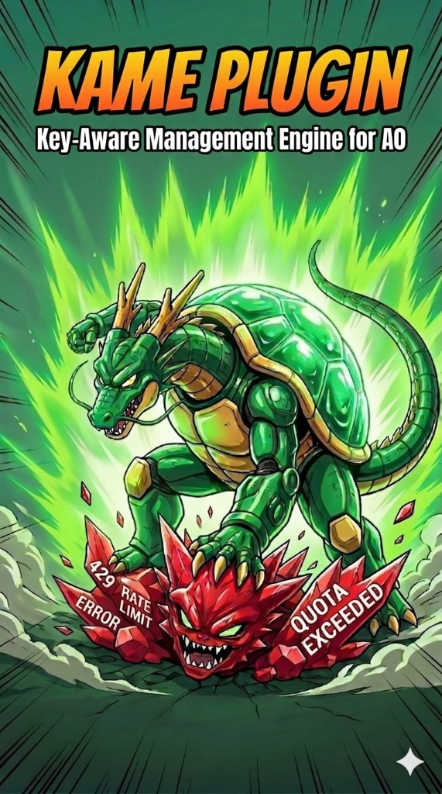
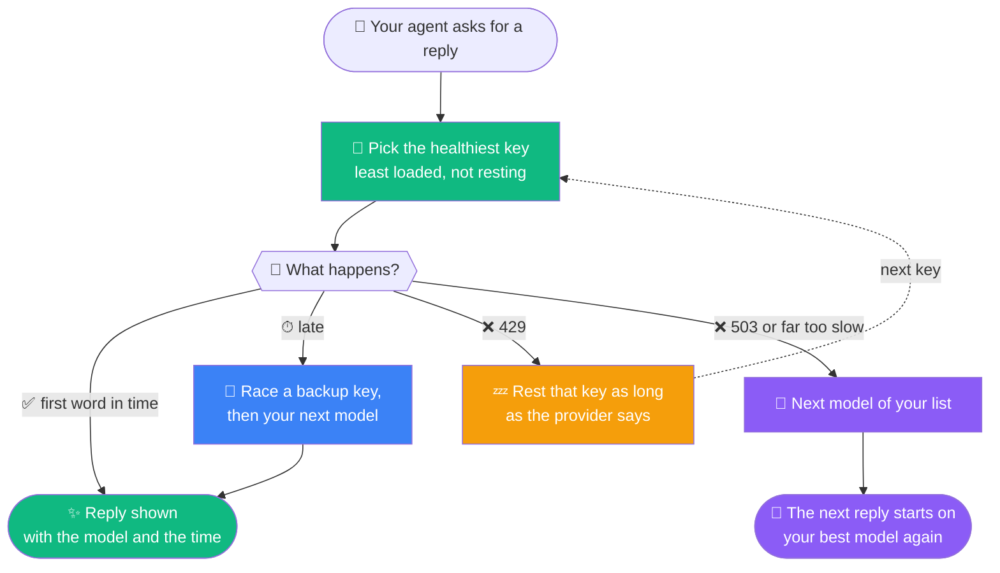

<div align="center">



# 🐢⚡ KAME — free API key rotation for Agent Zero

### What API key rotation should have been: all your keys and models, one agent that never waits.

[](CHANGELOG.md)
[](#verified)
[](#verified)
[](#privacy)
[](LICENSE)
[](https://github.com/Kame696/kame-api-rotation-for-agent-zero/stargazers)

**[⚡ Install in 1 minute](#install-fast) · [🆚 vs round-robin](#vs) · [🔬 How it works](#how) · [🖥️ Screenshots](#screens) · [❓ FAQ](#faq) · [Hermes version →](https://github.com/Kame696/kame-api-rotation-for-hermes)**

</div>

---

<a id="install-fast"></a>
## ⚡ Install in 1 minute

<table>
<tr>
<td width="33%" valign="top">

### 1️⃣ Install

Agent Zero → **Plugin Hub** → search **KAME** → *Install*.

Or unzip the [latest release](https://github.com/Kame696/kame-api-rotation-for-agent-zero/releases/latest) into `/a0/usr/plugins/`.

</td>
<td width="33%" valign="top">

### 2️⃣ Paste your keys

In a provider's **API key** field, comma-separated:

`key1,key2,key3`

Keys from different projects and accounts each bring their own quota.

</td>
<td width="33%" valign="top">

### 3️⃣ That's it

Everything is **automatic** — no settings to learn.

Watch it work in the **KAME** panel (central menu).

</td>
</tr>
</table>

## 🎯 Why people switch to KAME

Round-robin tools cycle your keys blindly and keep hitting the one that just failed. **KAME decides from the error itself** — and it never makes your agent wait for a slow model.

<table>
<tr>
<td width="50%" valign="top">

### ➕ Your quotas add up
Many free-tier keys, from many projects and accounts, become **one big pool**. 14 Gemini projects = 14× the free quota.

</td>
<td width="50%" valign="top">

### 🛡️ Never stuck on a 429
A `429`, `RESOURCE_EXHAUSTED`, a `503` or a dead key moves the call to the **next healthy key at once**. A resting key comes back by itself.

</td>
</tr>
<tr>
<td width="50%" valign="top">

### ⚡ Speed first
A late reply is **raced** by a backup key, then by your **next model**. Whichever answers first is shown, the rest is cut.

</td>
<td width="50%" valign="top">

### 🔀 Smart model fallback
Your best model **leads every reply**. A busy, spent or slow one hands over in seconds, and is tried first again soon after.

</td>
</tr>
<tr>
<td width="50%" valign="top">

### 🧠 Reads every error
The provider's **own retry time**, per-minute vs daily vs out of credit. **82 providers** learned from their own docs, no allowlist.

</td>
<td width="50%" valign="top">

### 👀 You see everything
Which **model answered** each reply and how long it took. A live panel with every key, rest and switch.

</td>
</tr>
</table>

## 🏎️ How fast? Measured live

On the author's own Gemini free-tier keys (4 fallback models × 14 keys), on a bad day for the newest model:

| Situation | Before 1.8.2.8 | **KAME 1.8.2.8** |
|---|---|---|
| Main model is **slow** (about 2 minutes for one word) | 46–120 s per reply | **2.6 s median** |
| Main model is **overloaded** (503) | stuck on it | next model answering in **8.3 s**, then at once |
| Main model is **out of quota** | next model, then stuck there up to 1 hour | switched in **0.3 s**, back on your best model next reply |
| Everything **healthy** | — | your main model, first word in **2–4 s** |

<sub>Measured on the Hermes build, which shares these rules; 8 messages in one session. See <a href="VALIDATION.md">validation and limits</a>.</sub>

<a id="vs"></a>
## 🆚 KAME vs round-robin

Most key rotators cycle keys in order and retry on a timer. KAME decides from the refusal itself.

| | Round-robin rotator | **KAME** |
|---|---|---|
| Which key is next | the next one in the list | **the least-loaded healthy key** (60-second window) |
| Parallel calls | all start on the same key | **spread across keys** (marked busy at hand-out) |
| After a 429 | retry on a fixed backoff | **the provider's own `retryDelay` / `Retry-After`, to the second** |
| Per-minute vs daily quota | same treatment | **told apart** (`quotaId`, reset hints, the pool's own behaviour) |
| Gemini bare `RESOURCE_EXHAUSTED` | fixed backoff or hammering | **1 → 2 → 4 → 8s … ladder, reset the moment the key answers** |
| Outage (5xx) | punishes every key | **1s, never escalates** — the key was never at fault |
| A key spent on one model | benched everywhere | **still used on your other models** |
| All keys resting | error, run over | **sleeps until the first recovery, and says so in the chat** |
| Longest a healthy key can be lost | whatever the provider claimed | **1 hour** (`max_hold_seconds`) |

<a id="how"></a>
## 🔬 How it works



<table>
<tr><th>Step</th><th>What KAME does</th></tr>
<tr><td>🔑 Pick</td><td>The key with the fewest requests in the last 60 s; a key is marked busy the moment it is handed out, so parallel agents spread across keys.</td></tr>
<tr><td>🏁 Race</td><td>Silent at about 2× the usual first word: a backup key of the same model. At about 3×: your next model also gets the request. First to answer wins.</td></tr>
<tr><td>💤 Rest</td><td>Exactly as long as the provider says, never more than an hour. A spent key still works on your other models.</td></tr>
<tr><td>🔀 Fallback</td><td>Your fallback models, one per line, in the KAME settings. Only models <b>you</b> listed, never after part of the reply is on screen, and every new reply starts on your best one.</td></tr>
</table>

<details>
<summary><b>📣 What's new in 1.8.2.8 and the versions before it</b></summary>

> **1.8.2.8 — speed first.** A reply still silent at about 3× its model's usual first word is raced by the next model of your list, and the first to answer is shown (live on the same rules: median reply 2.6 s on a day the newest Gemini took 2 minutes per word). Two keys answering "overloaded" (or timing out) move the reply to your next fallback model at once; every reply starts on your best model again, one KAME knows is busy is passed down without a request, and a model silent past its own slow bound hands the reply on; *Fallback* and *Wait for the first token* size themselves from what KAME learns about each model; every reply ends with one line naming the model that answered and how long it took. The same as Hermes inside the call, too: a cut answer continued on the next key, a silent key dropped, the agent told whether retrying helps. Offline suites 29 / 29; remote native acceptance on Agent Zero v2.12 / v2.13 / v2.14, 23 + 41 native checks per host. See [validation and limits](VALIDATION.md).

> **1.8.2.7 — every provider learned, your own fallback models, faster when quota runs dry.** 82 providers learned from their own documentation (774 error shapes), a fallback model list KAME uses by itself (Agent Zero has none), keys asked together when a pool runs dry, backup keys for a slow first word, and a panel in Agent Zero's central menu with Events. Offline suites 27 / 27 suites green (88 new 1.8.2.7 tests); remote native acceptance on Agent Zero v2.12 / v2.13 / v2.14 (16 / 16 CI jobs green, 23 + 27 native checks per host). See [validation and limits](VALIDATION.md).

> **1.8.1.8 — clean lifecycle and native interruption handling.** Uninstall/reload preserves other extensions, limiter patches no longer stack, and compression respects native stop/intervention exceptions. All 24 offline suites and remote native Agent Zero v2.12/v2.13 acceptance passed: [14 green CI jobs](https://github.com/Kame696/kame-api-rotation-for-agent-zero/actions/runs/37091291526). See [validation and limits](VALIDATION.md). No Agent Zero installation on the author's computer or real-provider 1.8.1.8 performance claim.

> **Historical real-provider evidence (1.8.1.6).** 1.8.1.6 ran in a real Agent Zero v2.12 session with 14 real Gemini keys: 12/12 calls answered (6 sequential, 6 concurrent), 48 provider 503s rotated at 1s each, all 14 keys used. It also passed all 23 offline suites, the v2.13 compatibility harness, and a cross-port check that gives the same decision as Hermes on all 2,679 recorded refusals.

</details>

<a id="install"></a>
## 🚀 Install

**From the Agent Zero Plugin Hub** — search for **KAME** and install.

**Or by hand** — copy this repository into your Agent Zero's user plugins folder as `api_rotation_by_kame`:

```
/a0/usr/plugins/api_rotation_by_kame/
```

Then **restart Agent Zero** once. Look for `🐢⚡ KAME v1.8.1.8 — ACTIVE` in the log.

| | |
|---|---|
| **Needs** | Agent Zero v1.14+ or the V2 line — nothing else, no extra package |
| **Configuration** | none required |
| **Uninstall** | remove the folder; `hooks.py` reverts every patch |

<a id="keys"></a>
## 🔑 Add your keys

In **Agent Zero → Settings → Model Provider**, paste all your keys into that provider's **one** API key field, separated by commas:

```
key1,key2,key3,key4
```

Or in `/a0/usr/.env`:

```
API_KEY_GOOGLE=AIzaSy...aaa,AIzaSy...bbb,AIzaSy...ccc
```

One key works too; there is just nothing to rotate to.

Or from any chat: `/kame-keys add AIza...,AIza...` (the provider is read from the
prefix; name it when it cannot be: `/kame-keys add deepseek sk-...,sk-...`), or
`/kame-keys import google keys.txt` to keep the keys out of the chat history.
Keys already there are skipped, and the previous `.env` is saved beside it as
`.env.kame-<timestamp>.bak` (plaintext like the `.env`, last 5 kept).

<a id="errors"></a>
## 🧠 How KAME reads every error

Every refusal is sized from what the provider actually sent. Decisions are made on the payload, never on the provider's name, so a provider that did not exist when this was written is covered by the same rules.

| The provider says | KAME does |
|---|---|
| **429 with a stated wait** (`retryDelay`, `Retry-After`, "retry in N s") | rests that key **exactly that long**, up to the 1-hour ceiling |
| **Gemini `429 RESOURCE_EXHAUSTED`, no number at all** | rests it **1s, then 2, 4, 8, 16, 32, 64s** on each repeat; back to 1s the moment it answers |
| **Any other throttle with no number** | a flat **30s** — measured: retried sooner, a refused key answered 0 of 73 times |
| **A daily quota** (e.g. `PerDay` in `quotaId`) | re-probes in **5 minutes** while other keys still answer; rests **1 hour** once the whole pool has been silent for 20 minutes |
| **Out of credit** | **1 hour**, and the key rests on **every model** of that provider — the account is empty, not the model |
| **5xx / overloaded** | **1 second**, never escalates — an outage is not the key's fault |
| **Timeout** (the attempt really waited) | next key at once; the key is not rested |
| **A connection that never opened** | 3 seconds, so a network outage cannot turn into a tight loop |
| **Bare 401** | 20s, doubling on a repeat, out of rotation after 3 in a row |
| **"This key is invalid / revoked"** | out of rotation at once — replace it and it comes back by itself |
| **403 for one model only** | that key skips that model and keeps working on the others |
| **Anything it cannot size** | a short rest and the next key; the error is never swallowed silently |
| **A reply cut mid-stream** after words were shown | the next key is sent what you saw and goes on from there; only new words reach the chat |
| **Accepted, then silence** (with `stream_silence_timeout_seconds` set) | that key is dropped after the wait and the next one tried |
| **An error that has to go back to Agent Zero** | ends with one line telling the agent whether retrying helps: a temporary issue, a spent daily quota, or a cause only you can fix |

<a id="screens"></a>
## 🖥️ What you see

- **The KAME panel** in Agent Zero's central menu (menu → **KAME**): each pool, the counters (switched model, backup keys, keys asked together), a "still waiting" line, **Events** for your conversation, **Background jobs** apart, your **Fallback models**, and the **Settings** — editable in place.
- **A rotation chip beside the composer** — how many keys are ready right now; a click shows every pool.
- **A notice in the chat** when every key is resting for more than ~90 seconds: how many are resting, when the earliest is back, and that **stop still works**. Counts only — never a key — and it never enters the model's history.
- **`/kame`** — build, pools, what is ready. **`/kame doctor`** — every kind of refusal beside the rest it got, how often it happened, and anything only a person can fix.
- **`/kame events`** — the last decisions, newest first: which key was refused and why, which took over, which answered, when the pool waited, when a setting changed.
- **`/kame get` · `/kame set <name> <value>` · `/kame reset <name|all>`** — every setting from the chat, in force on the next call. **`/kame clear-pool`** — every key starts again from zero.
- **`/kame-quota`** — per key and model: resting or ready, back in how long, and why. **`/kame-keys`** — add, import and inspect keys in bulk, masked.
- **One line per decision in the log**, with the key as an anonymous fingerprint (`k3f9a1`):

```
[KAME] Util|gemini-3.8-flash kfb76c ⏳ 503 server-busy → key cooled 1s · rotating to next key...
[KAME] Util|gemini-3.8-flash ✅ kaa51d · 2 rotations
[KAME] Chat|gemini-3.8-flash k0a770 ⏳ 429 per-minute → key waits 4s · rotating to next key... [backoff.3]
```

<details>
<summary><b>Everything inside</b></summary>

| | What it gives you |
|---|---|
| 🆔 **Identity-aware health** | Health per `provider:model` — a 429 on one model does not disable the key on another |
| 📊 **Predictive selection** | 60-second window per key; the least-loaded key wins, least recently used breaks the tie |
| 🛡️ **Anti-dogpile + anti-herd** | A key counts as busy the moment it is handed out, so concurrent calls pick different keys |
| 💤 **ETA-driven sleep** | When every key rests, sleep until the soonest recovery (checked at least every 60s, with a little jitter) — never call with a resting key |
| 🎯 **Evidence-sized rests** | The table above; the provider's number whenever it states one |
| 🪜 **RESOURCE_EXHAUSTED ladder** | 1-2-4-8…64s for Gemini's bare 429, reset by an answer |
| ⛔ **One-hour ceiling** | No hold survives `max_hold_seconds`, whatever set it |
| 🤝 **Delegated execution** | Agent Zero makes the call; KAME picks the key and binds to A0's model layer by shape, so A0 updates rarely break it |
| 📦 **Compression through the carousel** | History summarisation rotates keys too |
| 🔒 **Rate-limiter lock fix** | Replaces an `asyncio.Lock` that could deadlock under a specific concurrency pattern |
| 🧯 **Unusable-response floor** | Raises A0's "stop after N unparseable replies" to a floor (default 5), never a ceiling |
| 💬 **The wait, said out loud** | The chat notice above |
| 🗂️ **Events timeline** | The last 150 decisions in memory — refused, took over, answered, waited, handed back, setting changed |
| 📝 **Refusal recorder** | Every refusal to `refusals.jsonl`, keys removed first, 8 MB cap — evidence for the next rule, decides nothing |
| ⏱️ **Call timings** | One line per attempt to `calls.jsonl`: time to first sign, to first text, total, time already waited — no key, prompt or answer |
| 💾 **Key health across restarts** | Holds kept on disk as hashes; a restart does not re-spend calls on keys known to be out, and never holds past the ceiling |
| 🔌 **Off switches** | Turn KAME off, give back key selection, or stop rotating per call — without uninstalling |
| 🐢 **Same as the Hermes port** | Same error reader, same settings, same environment variables, same commands |
| 🧹 **Clean uninstall** | Every patch reverted by `hooks.py` |

</details>

<a id="settings"></a>
## ⚙️ Settings

Nothing needs changing. Six settings are on show; the rest sit under **Show advanced settings**, and the switches that turn a part of KAME off are folded under **Troubleshooting**. Every setting is also in the KAME panel and in `/kame get` / `/kame set`; most read an environment variable with the **same name as on the Hermes port** (the environment wins).

<details>
<summary><b>The ones worth knowing</b></summary>

| Setting | Default | What it does |
|---|---|---|
| `fallback_models` | empty | Your fallback models, one `provider/model` per line (optional `@ api_base`). When your chat model cannot answer and nothing has been shown yet, the first that can answers. Empty = never switch (`KAME_FALLBACK_MODELS`) |
| `model_switch` | `auto` | *Fallback*: your list is one pool with your chat model first. `auto` falls back at once when your provider is busy or every key rests, otherwise after about three times your model's usual first-word time (6–20 s, learned); every reply starts on your chat model again; `timed` ("Set time") after the number below; `never` (`KAME_MODEL_SWITCH`) |
| `failover_after_seconds` | `60` | *Fallback after*. With `model_switch: timed`: seconds a reply waits with nothing on screen before the next model answers it (`KAME_FAILOVER_AFTER`) |
| `reply_notice` | `always` | One line when a reply ends: its time and the model of each step; `switches` = only when a fallback model answered; `never` (`KAME_REPLY_NOTICE`) |
| `max_total_wait_seconds` | `0` | *Give up after* (advanced): `0` = never give up, wait for a key or use the fallback list; a number gives up with the error after that long (`KAME_MAX_TOTAL_WAIT`) |
| `hedge_mode` | `adaptive` | Speed: Balanced (`adaptive`) races a backup key for a slow first word and asks keys together when quota runs dry; Fastest (`max`) races every reply; Saver (`off`) one key at a time (`KAME_HEDGE_MODE`) |
| `probe_burst_max_legs` | `16` | Most keys asked together when quota runs dry; `0` = one by one (`KAME_PROBE_BURST`) |
| `first_token_wait` | `auto` | Wait for the first token: `auto` drops a key silent far past its model's usual first word (20–120 s, 60–300 s for thinking models; never a local model); `timed` the number below; `off` (`KAME_FIRST_TOKEN_WAIT`) |
| `stream_silence_timeout_seconds` | `0` | With `first_token_wait: timed`: seconds a key may stay silent (`KAME_STREAM_SILENCE_TIMEOUT`) |
| `stream_resume_limit` | `-1` | A reply cut mid-stream is continued on the next key from where it stopped, shown once; `-1` = while it progresses, `0` = start again (`KAME_STREAM_RESUME_LIMIT`) |
| `pacing_rpm_overrides` | empty | Requests per minute per model, e.g. `google:gemini/gemini-2.5-flash=10`; KAME also learns them from real 429s (`KAME_PACING_RPM_OVERRIDES`) |
| `key_region_overrides` | empty | Region per key for Vertex / Bedrock behind an endpoint that hides it, `k3f9a1=us-central1` (`KAME_KEY_REGION_OVERRIDES`) |
| `hedge_budget_pct` · `hedge_burst` · `hedge_quantile` · `hedge_cold_s` · `hedge_cold_reasoning_s` · `hedge_max_prompt_tokens` | `10` · `3` · `90` · `6` · `30` · `32000` | The speed boost's numbers, same as Hermes (`KAME_HEDGE_*`) |
| `max_hold_seconds` | `3600` | No key sits out longer than this (`KAME_MAX_HOLD`) |
| `unsized_throttle_backoff` | on | The 1-2-4-8s ladder for Gemini's bare `RESOURCE_EXHAUSTED` (`KAME_UNSIZED_BACKOFF`) |
| `unsized_backoff_max_seconds` | `64` | Where that ladder stops growing (`KAME_UNSIZED_BACKOFF_MAX`) |
| `unsized_throttle_rest_seconds` | `30` | Rest after any other throttle that names no wait (`KAME_UNSIZED_REST`) |
| `daily_quota_cooldown_seconds` | `3600` | Rest once a daily quota is confirmed by a silent pool |
| `kame_wait_notice` | on | The chat notice while every key rests |
| `kame_unusable_response_limit` | `5` | The floor under A0's unparseable-reply stop (`0` = leave A0 alone) |
| `kame_log_level` | `normal` | `silent` · `normal` · `verbose` · `verbose+errors` |
| `key_log_style` | `fingerprint` | How keys appear in logs; never the full key |
| `share_pool_health` | on | Keep key holds on disk so a restart does not forget them (`KAME_SHARE_POOL_HEALTH`) |
| `refusal_recorder_disabled` | off | Stop writing `refusals.jsonl` (`KAME_RECORDER_DISABLED`) |
| `call_timings_disabled` | off | Stop writing `calls.jsonl` (`KAME_CALL_TIMINGS_DISABLED`) |
| `rotation_disabled` | off | Turn KAME off without uninstalling it (`KAME_ROTATION_DISABLED`) |
| `spread_disabled` | off | First ready key in the order written, not the least loaded (`KAME_SPREAD_DISABLED`) |
| `carousel_disabled` | off | One attempt per call; the error goes back to Agent Zero (`KAME_CAROUSEL_DISABLED`) |
| `hedging_disabled` | off | No backups and no keys asked together: one key at a time (`KAME_HEDGING_DISABLED`) |
| `stream_stitch_disabled` | off | A cut reply starts again instead of continuing (`KAME_STREAM_STITCH_DISABLED`) |

</details>

<a id="privacy"></a>
## 🔒 Privacy

- **KAME never prints, logs or sends a key.** Logs, the chip, the chat notice and `/kame` carry fingerprints and counts only.
- **No telemetry, no network call of its own, no third-party package.** Agent Zero makes every model call.
- **What stays on disk** lives in `usr/plugin-data/api_rotation_by_kame/`: `refusals.jsonl` (keys removed before writing), `calls.jsonl` (durations and fingerprints only) and `pool-health.json` (a hash of each key, never the key). Each has an off switch.
- **`/kame-keys add|import`** write `usr/.env`, after saving the previous file as `.env.kame-<timestamp>.bak` beside it — plaintext, like the `.env` itself; the last 5 are kept.

<a id="verified"></a>
## ✅ Verified

| Check | Result |
|---|---|
| **1.8.2.7** — remote native acceptance, real Agent Zero v2.12 / v2.13 / v2.14, real LiteLLM/OpenAI SDK over local TCP | 16 / 16 CI jobs green, 23 + 27 native checks per host: a backup key answered before a slow key's 4 s; the fallback list answered through Agent Zero's own model factory when every key rested and on a closed door, and the next call went back to the configured model; the panel's API answered in the host's real plugin layout, no key in any report |
| **1.8.2.7** — provider answer keys, 82 providers, 774 documented error shapes | family 674 · action 675 (Hermes 1.8.2.7: 670 · 670); same floors in the LiteLLM shape (670 · 674) |
| **1.8.2.7** — upgrade check | **15 / 15** patch points and **16 / 16** host facts on v2.12, v2.13 and v2.14 |
| **1.8.2.7** — offline suites | 27 / 27 suites green (88 new 1.8.2.7 tests) |
| **1.8.2.7** — three adversarial reviews | 4 high and 8 medium findings, all fixed, each pinned by a test that fails on the build the review read |
| Two real sessions — Agent Zero v2.12 code, real LiteLLM, 14 real Gemini keys | **26 / 26 answered**, 16 of them concurrent; 13 real `503`s absorbed at 1s each; all 14 keys carried traffic |
| A third real session, after the parity work — Agent Zero v2.12, real LiteLLM, NVIDIA NIM, 2 real keys | **12 / 12 answered**, 6 of them concurrent, the two keys sharing the load evenly; every refusal, hold and timing written to disk with **no key fragment** in any file. The same day's Gemini pool (14 keys) was out of its daily quota: every key got a `PerDay` refusal, a 5-minute re-probe, and the holds survived a restart of the process; a retired model (`410 Gone`) was handed back to Agent Zero instead of rotated |
| A fourth real session, on 1.8.1.6 — Agent Zero v2.12 code, real LiteLLM, 14 real Gemini keys | **12 / 12 answered**, 6 of them concurrent; 48 real `503`s absorbed at 1s each; all 14 keys carried traffic |
| Live harness — KAME's real patches applied to a real Agent Zero checkout | **all green** on v2.11, v2.12 and v2.13 |
| Upgrade check — every Agent Zero symbol KAME touches | **15 / 15** fingerprints (three new in 1.8.1.0: the plugin config writer, the `.env` writer, the script-command runner) and **12 / 12** host facts hold on v2.12 and v2.13 |
| Offline tests | **24 / 24** suites green through `tests/run_all.py` (standalone scripts and pytest files, through 1.8.1.8) |
| Answer-key gate — 1,897 real recorded refusals, judged by each port's own engine | A0 and Hermes agree on **every field** (family 100, window 99.69, scope 99.88, action 98.89) |
| Adversarial review | a second model tried to break the port; its 8 findings are fixed and each is now a test |

The real sessions ran with Agent Zero's `nest_asyncio` shim replaced by a no-op, because it breaks HTTP timeouts on the Python 3.14 used for the test; Agent Zero's own Docker image runs an older Python where the shim works. The tool is `tools/live_a0_session.py`.

<a id="history"></a>
## 🪪 Version history

In development since early 2026, and every release came from a real log, not from theory. One line per version here; the full story of each is in [CHANGELOG.md](CHANGELOG.md).

> **v1.8.1.0's error reader, by the numbers:** built from **13,561 real
> refusals** (311 distinct messages) and graded against an independent answer
> key of **68 error shapes, sorted into 11 kinds of error, across 12 providers
> and gateways** — Google Gemini, OpenAI, OpenAI Codex, Anthropic, NVIDIA,
> OpenRouter, Groq, DeepSeek, AIHubMix, TokenRouter, ZenMux and GLM. Every
> verdict comes from the payload itself — status, structured error code,
> headers, then prose — never from a list of known provider names, so a
> provider outside these 12, including one that does not exist yet, is read
> by the same rules on its first refusal.

<details>
<summary><b>Every version, one line each (click to open)</b></summary>

| Version | Focus | In one line |
|---|---|---|
| **v1.8.2.8** | Busy providers, automatic waits, who answered | Two keys "overloaded" or timing out move the reply to your next fallback model at once (the busy model left alone for a while); the switch counts your wait; every reply starts on your best model again; *Fallback* and *Wait for the first token* are Automatic, learned per model; a line naming the model and time ends every reply. Hermes parity inside the call: cut answers continued, silent keys dropped, retry hints the agent reads, learned pacing, the faster key first, region in the pool. |
| **v1.8.2.7** | Every provider learned, your own fallback models, faster when quota runs dry | 82 providers learned from their own documentation (774 error shapes, A0 ≥ Hermes on every field). A fallback model list KAME uses by itself — Agent Zero has none. Backup keys for a slow first word; 4 → 8 → 16 keys asked together when a pool runs dry. A panel in the central menu: Overview, Events, Background jobs, Fallback models, Settings. Six settings on show, `max_total_wait_seconds` new. Remote native acceptance on v2.12 / v2.13 / v2.14. |
| **v1.8.1.8** | Clean lifecycle, native stops, remote acceptance | Owned bindings preserve foreign extensions and updated host methods on reload; rate limiter methods/locks restore cleanly; compression propagates stop/intervention. 18 targeted regressions, 24 suites, 14 CI jobs; native v2.12/v2.13 with actual SDK/TCP interruption tests. Classifier, selector and native execution preserved. |
| **v1.8.1.6** | Keys land where Agent Zero reads them | `/kame-keys add` no longer takes the first word of a sentence for a provider (`add my keys sk-…` wrote into `API_KEY_MY`, which nothing reads): the word must be a provider Agent Zero knows, or one your `.env` already has keys for, otherwise KAME asks. `/kame-keys import` reads UTF-16 and UTF-32 files of either byte order. |
| **v1.8.1.5** | Only keys go in; the ceiling holds *(inside the v1.8.1.6 release)* | `/kame-keys add` and `import` write only what looks like a key: the words around a paste ("my keys: …"), a whole `OPENAI_API_KEY=…` line or a key mangled by the copy (a zero-width space, smart quotes) no longer land in the `.env` as keys — the rejected ones are listed, masked. A rest can no longer outlast `max_hold_seconds` when the computer's clock steps back (a 30s rest had become two hours) or when the ceiling is lowered mid-rest. |
| **v1.8.1.4** | Same brain as Hermes, closer *(inside the v1.8.1.6 release)* | A cross-port replay of 877 recorded refusal shapes found nine places this port decided differently from Hermes; each is fixed with a test. A busy server ("overloaded") is a server, not a spent key, and a stated server wait is obeyed; a context-too-long error is handed back instead of read as a rate limit because a token count contains 429; a flagged prompt is handed back, a key denial still rotates; Codex's `usage_not_included` is billing by its field. Key backups are owner-only from the first byte; the debug error dump no longer prints a key. |
| **v1.8.1.3** | Checked against Agent Zero v2.13 *(inside the v1.8.1.6 release)* | No runtime change. Compatibility re-verified on v2.13 (live harness green, 12/12 host facts; the one changed symbol is `adaptive`). The upgrade checker no longer mistakes a module its Python cannot parse for a missing symbol. `tests/run_all.py` runs every suite the right way. CI workflows added. |
| **v1.8.1.2** | Ran on a real Agent Zero; one set of settings per process | Verified in a real Agent Zero v2.12 session (12/12 answered). `/kame set` is global again (1.8.1.1's per-profile file let subordinates flip the dials). `.env` import of `GEMINI_API_KEY` / `NVIDIA_API_KEY` lands in `API_KEY_GOOGLE` / `API_KEY_NVIDIA_NIM`. The resting wait keeps its padding. A billing refusal no wait fixes goes back to Agent Zero once every key said so. Same decision as Hermes on all 1,984 recorded refusals. |
| **v1.8.1.1** | Reliability patch for reset and account holds | Account-wide holds remain independent of model holds; reset reports persistence failures instead of claiming success; a resting pool re-checks after each sleep slice. Project/profile settings writes, dotenv import backups, evidence redaction and call IDs are hardened. Offline tests and Agent Zero v2.12 compatibility checks passed. **This version was not installed into Agent Zero for a real-provider session; the sessions below belong to v1.8.1.0.** |
| **v1.8.1.0** | Every refusal sized from its own evidence | A new error reader since v1.2.0, built from **13,561 real refusals** and graded against **68 error shapes** (11 kinds) across **12 providers and gateways** — Gemini, OpenAI, Codex, Anthropic, NVIDIA, OpenRouter, Groq, DeepSeek, AIHubMix, TokenRouter, ZenMux, GLM — evidence-based, so an untested provider reads by the same rules. The provider's own number is obeyed and never inflated, per-minute told from per-day, a daily label costs a 5-minute re-probe instead of an hour, 5xx never escalates. Gemini's bare `429 RESOURCE_EXHAUSTED` climbs a 1-2-4-8…64s ladder, reset the moment a key answers; no key is held longer than an hour; a throttle with no number rests 30s; a real timeout rotates without benching; out of credit rests the key on every model. **Same features as the Hermes 1.8.1.0:** its error reader, `/kame events`, refusal recorder and call timings, key health across restarts, off switches, `/kame get·set·reset`, `/kame-quota`, `/kame-keys` — same setting names and environment variables. Verified in real sessions on A0 **v2.12**. |
| **v1.7.0.5** | Three numbers, measured on real keys | A daily-quota label alone buys a 5-minute re-probe, not an hour (refused keys came back in 6–36 minutes, 21 of 21); a retry hint in **milliseconds** is no longer read as minutes; a **5xx never escalates**. Shipped inside 1.8.1.0. |
| **v1.2.0** | The wait, said out loud | An all-keys-cooling wait now appears **in the chat**, not only on the console, and the settings screen was rebuilt so an on-by-default toggle stops rendering as off. Verified on A0 **v2.10**. |
| **v1.0.9** | KAME stops re-implementing Agent Zero | KAME only **chooses the key**; A0 owns the request, the stream, the parsing and the result. Live-verified on six A0 tags, one code path. |
| **v1.0.8** | Early stop + denied keys | The stream breaks where native A0 breaks it, and a `403 PERMISSION_DENIED` is quarantined instead of returning to the carousel every 20 seconds. |
| **v1.0.7** | Response Shield | A `response` tool arriving with empty or wrongly-keyed arguments is healed instead of crashing the turn. |
| **v1.0.6** | Faster failover, honest numbers | Zero-delay rotation (~750 ms saved per 15-key storm), the provider's own quota tag printed inline, one transient empty stream forgiven. |
| **v1.0.5** | Daily quota, correctly | An existing cooldown can never be shortened, and the carousel honours chat **pause**. |
| **v1.0.4** | Alive on Agent Zero V2 / V2.1 | V2 moved streaming and V2.1 split the entry point — rotation was being bypassed. One engine now serves both majors. |
| **v1.0.3** | Observability + faster recovery | Two real Gemini 503 outages (one **83 minutes**) made the logs readable: precise durations, storm collapse, fast pool thaw. |
| **v1.0.2** | A 5xx is not a daily quota | A 503 whose body mentioned "daily" cooled the whole pool for an hour. Any 5xx is now a short server retry. |
| **v1.0.1** | Quota awareness across providers | Strict daily/account detection, adaptive backoff, and a `silent`/`normal`/`verbose` log switch. |
| **v1.0.0** | First stable release | Validated in production: 1,163 operations, 117 rate limits, 0 crashes. |
| v0.5.x | The Commander → The Trust | Identity-aware health, anti-dogpile, anti-thundering-herd, sleeping exactly until the next key recovers. |
| v0.4.x | The Seed → The Strategist | Foundational rotation, the eternal carousel, basic RPM awareness. |

</details>

<a id="faq"></a>
## ❓ FAQ

<details>
<summary><b>Does it work with OpenAI, Anthropic, OpenRouter — not just Gemini?</b></summary>

Yes. KAME decides from the refusal — retry timing, headers, the shape of the error body — never from who the provider is.
</details>

<details>
<summary><b>Why does Gemini say <code>RESOURCE_EXHAUSTED</code> on every key at once?</b></summary>

Gemini's quotas are per Google Cloud project, and a bare `429 RESOURCE_EXHAUSTED` with no `quotaId` and no `retryDelay` often arrives on many keys at the same moment and clears on all of them together — which points at a busy model rather than at your quota. KAME retries those keys on a short 1-2-4-8s ladder instead of benching them, and the first key that answers resets its own ladder.
</details>

<details>
<summary><b>A key was rested for an hour. Is that a bug?</b></summary>

Only a confirmed daily quota or an empty balance rests a key that long. A daily label alone buys a 5-minute re-probe; the hour applies once the whole pool has gone 20 minutes without a single answer. Nothing is ever held longer than `max_hold_seconds`.
</details>

<details>
<summary><b>Will an Agent Zero update break it?</b></summary>

Rarely, by design: Agent Zero makes the call and KAME only chooses the key. Every release is checked with `tools/a0_upgrade_check.py`, which fingerprints each Agent Zero function KAME touches and runs the live harness against the new checkout. If a future Agent Zero ever moves out from under it, KAME prints one line and steps aside — your agent keeps running.
</details>

<details>
<summary><b>I only have one key. Does KAME help?</b></summary>

Yes: the right wait for each error, the one-hour ceiling, the chat notice and the unusable-response floor all apply. It simply has nothing to rotate to.
</details>

---

<a id="hermes"></a>
## 🐢 Also for Hermes

The same engine, ported to the [Hermes agent](https://github.com/NousResearch/hermes-agent): **[kame-api-rotation-for-hermes](https://github.com/Kame696/kame-api-rotation-for-hermes)**.

## 🐢 Author

KAME API Rotation is designed and built by **KAME** — [github.com/Kame696](https://github.com/Kame696). Free, MIT, built against real quotas: no company, no telemetry, nothing to upsell.

If it saved you a run, a ⭐ on [the repository](https://github.com/Kame696/kame-api-rotation-for-agent-zero) costs nothing and helps other people find it.

## 📜 License

MIT — see [LICENSE](LICENSE). Bugs and ideas: [issues](https://github.com/Kame696/kame-api-rotation-for-agent-zero/issues).

<div align="center">

🐢⚡ **KAME 1.8.1.8** — *because round-robin was never enough*

</div>
