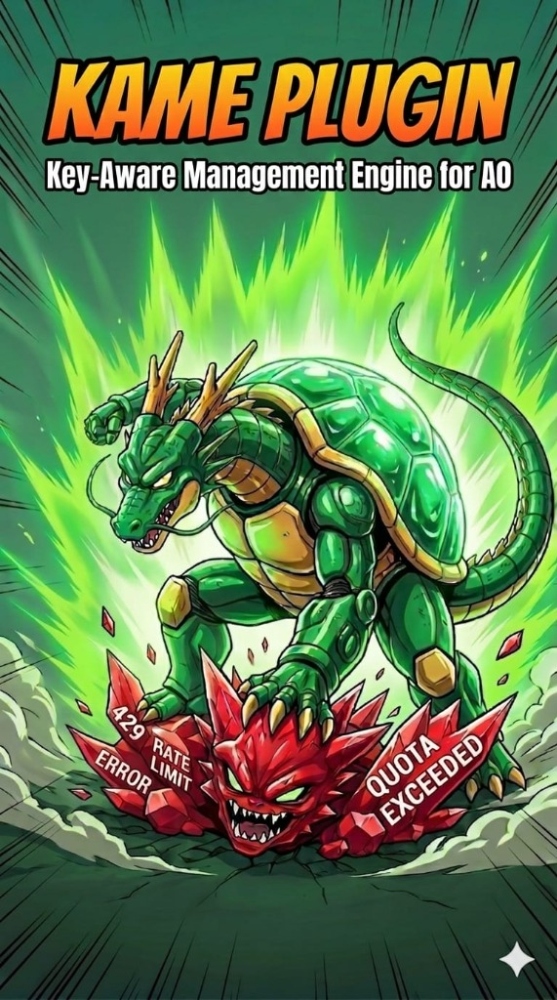
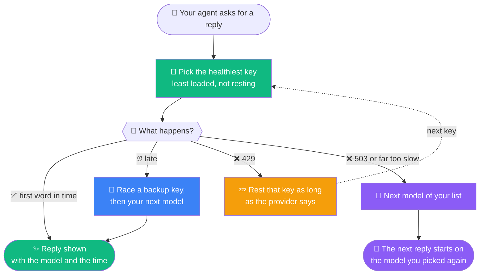

<div align="center">



# 🐢⚡ KAME — free API key rotation for Agent Zero

### All your API keys and models as one pool. A `429`, a spent quota or a slow model never stops your agent again.

[](CHANGELOG.md)
[](#verified)
[](#verified)
[](LICENSE)
[](https://github.com/Kame696/kame-api-rotation-for-agent-zero/stargazers)

**Free and open source** · Gemini, OpenRouter, OpenAI, Anthropic, NVIDIA, DeepSeek and any other provider · made by **[KAME](https://github.com/Kame696)**

**[⚡ Install](#install-fast) · [🖥️ Screenshots](#screens) · [🔬 How it works](#how) · [❓ FAQ](#faq) · [Hermes version →](https://github.com/Kame696/kame-api-rotation-for-hermes)**

</div>

---

## 🎯 Two jobs in one plugin

Most key rotators only do the first one.

<table>
<tr>
<td width="50%" valign="top">

### 🔁 Rotation — more quota
All your keys, projects and accounts become **one pool** (14 Gemini projects = 14× the free quota). A `429`, a daily quota or a dead key moves the call to the **next healthy key at once**, and the refused key rests **exactly as long as the provider says**.

</td>
<td width="50%" valign="top">

### ⚡ Racing — less waiting
A reply that is **late**, **stops mid-thought** or **goes silent half-way** is sent again to another key or your **next model**. The first to answer is shown, the rest is cut. Extra requests only when a reply is stuck.

</td>
</tr>
</table>

Also: 🔀 **your model leads** — every reply starts on the model you picked; your fallback list takes over only when it is busy, spent or slow · 🧠 **reads every error** — 82 providers learned from their own docs · 👀 **you see everything** — which model answered each reply, and how long it took.

<a id="vs"></a>
## 🆚 KAME vs round-robin

Most key rotators cycle keys in order and retry on a timer. KAME decides from the refusal itself.

| | Round-robin rotator | **KAME** |
|---|---|---|
| Which key is next | the next one in the list | **the least-loaded healthy key** (60-second window) |
| Parallel calls | all start on the same key | **spread across keys** (marked busy at hand-out) |
| After a 429 | retry on a fixed backoff | **the provider's own `retryDelay` / `Retry-After`, to the second** |
| Per-minute vs daily quota | same treatment | **told apart** (`quotaId`, reset hints, the pool's own behaviour) |
| Gemini bare `RESOURCE_EXHAUSTED` | fixed backoff or hammering | **1 → 2 → 4 → 8s … ladder, reset the moment the key answers** |
| Outage (5xx) | punishes every key | **1s, never escalates** — the key was never at fault |
| A key spent on one model | benched everywhere | **still used on your other models** |
| All keys resting | error, run over | **sleeps until the first recovery, and says so in the chat** |
| Longest a healthy key can be lost | whatever the provider claimed | **1 hour** (`max_hold_seconds`) |

<a id="install-fast"></a>
## ⚡ Install in 1 minute

<table>
<tr>
<td width="33%" valign="top">

### 1️⃣ Install

Agent Zero → **Plugin Hub** → search **KAME** → *Install*.

Or unzip the [latest release](https://github.com/Kame696/kame-api-rotation-for-agent-zero/releases/latest) into `/a0/usr/plugins/`.

</td>
<td width="33%" valign="top">

### 2️⃣ Paste your keys

In the provider's **API key** field, put **all your keys, separated by commas**:

`key1,key2,key3`

No command needed (details below the table).

</td>
<td width="33%" valign="top">

### 3️⃣ That's it

Everything is **automatic** — no settings to learn.

Watch it work in **API Rotation** (central menu).

</td>
</tr>
</table>

> **🔑 All your keys in one field, no command**
>
> 1. In Agent Zero open **Settings → Model Provider** (or the file `/a0/usr/.env`).
> 2. In your provider's **API key** field, **delete the key that is there** and paste **all your keys for that provider, separated by commas**.
> 3. Save. Do the same for every provider you use.
>
> ```
> API_KEY_GOOGLE=AIza...key1,AIza...key2,AIza...key3
> API_KEY_OPENROUTER=sk-or-...key1,sk-or-...key2
> ```
>
> Keys from different projects and accounts each bring their own quota. Prefer the chat? `/kame-keys add AIza...,AIza...` does the same.

<details>
<summary><b>Step by step — install by hand, add your keys</b></summary>
<a id="install"></a>

### Install

**From the Agent Zero Plugin Hub** — search for **KAME** and install.

**Or by hand** — copy this repository into your Agent Zero's user plugins folder as `api_rotation_by_kame`:

```
/a0/usr/plugins/api_rotation_by_kame/
```

Then **restart Agent Zero** once. Look for `🐢⚡ KAME v1.9.0.4 — ACTIVE` in the log.

| | |
|---|---|
| **Needs** | Agent Zero v1.14+ or the V2 line — nothing else, no extra package |
| **Configuration** | none required |
| **Uninstall** | remove the folder; `hooks.py` reverts every patch |
<a id="keys"></a>

### Add your keys

In **Agent Zero → Settings → Model Provider**, paste all your keys into that provider's **one** API key field, separated by commas:

```
key1,key2,key3,key4
```

Or in `/a0/usr/.env`:

```
API_KEY_GOOGLE=AIzaSy...aaa,AIzaSy...bbb,AIzaSy...ccc
```

One key works too: a stalled reply is asked again on it and a busy model hands the reply to your next one; more keys add rotation.

Or from any chat: `/kame-keys add AIza...,AIza...` (the provider is read from the
prefix; name it when it cannot be: `/kame-keys add deepseek sk-...,sk-...`), or
`/kame-keys import google keys.txt` to keep the keys out of the chat history.
Keys already there are skipped, and the previous `.env` is saved beside it as
`.env.kame-<timestamp>.bak` (plaintext like the `.env`, last 5 kept).

</details>

<a id="screens"></a>
## 🖥️ What you see

- **The API Rotation page** in Agent Zero's central menu (menu → **API Rotation**): three sentences first (what is happening, is anything wrong, what next), one ring per model in the order of your fallback list with one segment per key, what KAME did, and the three settings you reach for; everything older (counters, "still waiting", where your quota went) is folded under **Details**. Tabs: **Overview**, **Settings** (editable in place), **Fallback models** (rows with a model search), **Events** for your conversation and **Background jobs** apart. Click a ring to see that model's keys, with **Wake this model** and **Try this model now**.
- **A rotation chip beside the composer** — how many keys are ready right now; a click shows every provider and key (models that share one key are one row) and the last decisions, grouped.
- **The wait, on the chat's own status line** (the "Calling LLM..." line): when every key is resting, it says which model or key KAME waits for, how many keys are ready and when the next one is back. Counts only — never a key — and nothing is added to the chat or to the model's history. There is no pop-up. Turn it off with `kame_wait_notice` and the line stays as Agent Zero writes it.

<details>
<summary><b>💬 Commands and the log</b></summary>

- **`/kame`** — build, pools, what is ready. **`/kame doctor`** — every kind of refusal beside the rest it got, how often it happened, and anything only a person can fix.
- **`/kame events`** — the last decisions, newest first: which key was refused and why, which took over, which answered, when the pool waited, when a setting changed.
- **`/kame get` · `/kame set <name> <value>` · `/kame reset <name|all>`** — every setting from the chat, in force on the next call. **`/kame clear-pool`** — every key starts again from zero.
- **`/kame-quota`** — per key and model: resting or ready, back in how long, and why. **`/kame-keys`** — add, import and inspect keys in bulk, masked.
- **One line per decision in the log**, with the key as an anonymous fingerprint (`k3f9a1`):

```
[KAME] Util|gemini-3.8-flash kfb76c ⏳ 503 server-busy → key cooled 1s · rotating to next key...
[KAME] Util|gemini-3.8-flash ✅ kaa51d · 2 rotations
[KAME] Chat|gemini-3.8-flash k0a770 ⏳ 429 per-minute → key waits 4s · rotating to next key... [backoff.3]
```

</details>

<details>
<summary><b>Everything inside</b></summary>

| | What it gives you |
|---|---|
| 🆔 **Identity-aware health** | Health per `provider:model` — a 429 on one model does not disable the key on another |
| 📊 **Predictive selection** | 60-second window per key; the least-loaded key wins, least recently used breaks the tie |
| 🛡️ **Anti-dogpile + anti-herd** | A key counts as busy the moment it is handed out, so concurrent calls pick different keys |
| 💤 **ETA-driven sleep** | When every key rests, sleep until the soonest recovery (checked at least every 60s, with a little jitter) — never call with a resting key |
| 🎯 **Evidence-sized rests** | The table above; the provider's number whenever it states one |
| 🪜 **RESOURCE_EXHAUSTED ladder** | 1-2-4-8…64s for Gemini's bare 429, reset by an answer |
| ⛔ **One-hour ceiling** | No hold survives `max_hold_seconds`, whatever set it |
| 🤝 **Delegated execution** | Agent Zero makes the call; KAME picks the key and binds to A0's model layer by shape, so A0 updates rarely break it |
| 📦 **Compression through the carousel** | History summarisation rotates keys too |
| 🔒 **Rate-limiter lock fix** | Replaces an `asyncio.Lock` that could deadlock under a specific concurrency pattern |
| 🧯 **Unusable-response floor** | Raises A0's "stop after N unparseable replies" to a floor (default 5), never a ceiling |
| 💬 **The wait, said out loud** | The status-line text above |
| 🗂️ **Events timeline** | The last 150 decisions in memory — refused, took over, answered, waited, handed back, setting changed |
| 📝 **Refusal recorder** | Every refusal to `refusals.jsonl`, keys removed first, rotating (keeps the last ~8 MB) — evidence for the next rule, decides nothing |
| ⏱️ **Call timings** | One line per attempt to `calls.jsonl`: time to first sign, to first text, total, time already waited — no key, prompt or answer; rotating, keeps the last ~4 MB |
| 💾 **Key health across restarts** | Holds kept on disk as hashes; a restart does not re-spend calls on keys known to be out, and never holds past the ceiling |
| 🔌 **Off switches** | Turn KAME off, give back key selection, or stop rotating per call — without uninstalling |
| 🐢 **Same as the Hermes port** | Same error reader, same settings, same environment variables, same commands |
| 🧹 **Clean uninstall** | Every patch reverted by `hooks.py` |

</details>

<a id="how"></a>
## 🔬 How it works



<table>
<tr><th>Step</th><th>What KAME does</th></tr>
<tr><td>🔑 Pick</td><td>The key with the fewest requests in the last 60 s; a key is marked busy the moment it is handed out, so parallel agents spread across keys.</td></tr>
<tr><td>🏁 Race</td><td>Silent at about 2× the usual first word: a backup key of the same model. At about 3×: your next model also gets the request. A reply that thinks and then goes quiet is asked again; one that stops half-way is continued. First to answer wins.</td></tr>
<tr><td>💤 Rest</td><td>Exactly as long as the provider says, never more than an hour. A spent key still works on your other models.</td></tr>
<tr><td>🔀 Fallback</td><td>Your fallback models, one per line, in the KAME settings. Only models <b>you</b> listed, never after part of the reply is on screen, for any model a reply starts on (that model, then your main model, then the rest of the list), and every new reply starts on the model you picked.</td></tr>
</table>

<a id="privacy"></a>
## 🔒 Privacy

- **KAME never prints, logs or sends a key.** Logs, the chip, the chat notice and `/kame` carry fingerprints and counts only.
- **No telemetry, no network call of its own, no third-party package.** Agent Zero makes every model call.
- **What stays on disk** lives in `usr/plugin-data/api_rotation_by_kame/`: `refusals.jsonl` (keys removed before writing), `calls.jsonl` (durations and fingerprints only) and `pool-health.json` (a hash of each key, never the key). Each has an off switch. The two logs rotate instead of stopping: the current file and one previous generation (`calls.1.jsonl`, `refusals.1.jsonl`) are kept, and each rotation prints one line in the console.
- **`/kame-keys add|import`** write `usr/.env`, after saving the previous file as `.env.kame-<timestamp>.bak` beside it — plaintext, like the `.env` itself; the last 5 are kept.

<a id="faq"></a>
## ❓ FAQ

<details>
<summary><b>Is it free?</b></summary>

Yes, completely: MIT license, no account, no telemetry, nothing to upsell. You keep paying only your provider, as before — and it works on free tiers such as Gemini's.
</details>

<details>
<summary><b>Does it work with OpenAI, Anthropic, OpenRouter — not just Gemini?</b></summary>

Yes. KAME decides from the refusal — retry timing, headers, the shape of the error body — never from who the provider is.
</details>

<details>
<summary><b>Why does Gemini say <code>RESOURCE_EXHAUSTED</code> on every key at once?</b></summary>

Gemini's quotas are per Google Cloud project, and a bare `429 RESOURCE_EXHAUSTED` with no `quotaId` and no `retryDelay` often arrives on many keys at the same moment and clears on all of them together — which points at a busy model rather than at your quota. KAME retries those keys on a short 1-2-4-8s ladder instead of benching them, and the first key that answers resets its own ladder.
</details>

<details>
<summary><b>A key was rested for an hour. Is that a bug?</b></summary>

Only a confirmed daily quota or an empty balance rests a key that long. A daily label alone buys a 5-minute re-probe; the hour applies once the whole pool has gone 20 minutes without a single answer. Nothing is ever held longer than `max_hold_seconds`.
</details>

<details>
<summary><b>Will an Agent Zero update break it?</b></summary>

Rarely, by design: Agent Zero makes the call and KAME only chooses the key. Every release is checked with `tools/a0_upgrade_check.py`, which fingerprints each Agent Zero function KAME touches and runs the live harness against the new checkout. If a future Agent Zero ever moves out from under it, KAME prints one line and steps aside — your agent keeps running.
</details>

<details>
<summary><b>I only have one key. Does KAME help?</b></summary>

Yes: the right wait for each error, the one-hour ceiling, the chat notice and the unusable-response floor all apply. A reply that stops mid-thought is asked again on the same key, a busy refusal moves the reply to your next model at once, and an answer that goes silent half-way is continued.
</details>

<details>
<summary><b>How is KAME different from LiteLLM or another gateway?</b></summary>

A gateway is a server you run in front of your clients. KAME is a plugin inside the agent: nothing else to start, and it knows the model you picked, your fallback list and the reply already on screen — so it can race a slow reply, which no gateway we searched does. Gateways are ahead on cost tracking and on serving any client. The full comparison is under [More details](#gateways).
</details>

---

## 📚 More details

Optional reading — everything above is all you need. Click a line to open it.

<a id="fast"></a>
<details>
<summary><b>🏎️ How fast? Measured live</b></summary>

On the author's own Gemini free-tier keys (four models of one provider × 14 keys), November 2026:

| Situation | What happens |
|---|---|
| Your **two best models overloaded** (503) | the next model answers: first sign of work **2.7 s** median, none over 20 s (10 live replies) |
| A model **stops mid-thought** | asked again on another key once it is quiet past its own limit (8–20 s), then on your next model or provider |
| An answer **goes silent half-way** | continued after 45 s, where it could sit for minutes before |
| A key **out of quota** | the next key or model at once; the spent key still works on your other models |

<sub>Live numbers from the Hermes port, which shares these rules; the rows without a number are rules, each tested in the plugin's suite. See <a href="VALIDATION.md">validation and limits</a>.</sub>

<details>
<summary><b>💸 What can cost extra requests</b></summary>

Speed has a price, and it is yours: some of what makes KAME fast sends a request **beyond the one you asked for**, and your provider may bill it. They are: a **backup key** for a slow first word, **the next model racing** a slow reply, **one more model joining** at the slow bound, a reply that thinks and then goes quiet **asked at most twice more**, an answer that goes silent half-way **continued once**, and the occasional **ask of a busy best model** (at most 3 a minute, only while replies are flowing). **Saver** sends no backup key, no race and no ask beside the reply (when every model is busy it still asks your best one on the 20-second clock, instead of key after key as before); **Balanced** spends up to 1.1× the requests of a day, **Faster** up to 1.3× (at the default budget). The *Extra requests this hour* line on the API Rotation page shows what was really spent. Background jobs (chat names, memory, compression) never send backups or races, and have a budget of their own; an important one also goes **down your list** to another model when your best model is busy, and again before it gives up (your provider may bill those requests). A job KAME does not recognise keeps the old endless wait. `KAME_AUX_UNBOUNDED=1` in the environment gives the conversation's endless wait back to every background job, as in 1.8.2.8.

</details>

</details>

<a id="gateways"></a>
<details>
<summary><b>🧭 KAME and the big gateways</b></summary>

LiteLLM, CLIProxyAPI, new-api, Portkey and Bifrost are **gateways**: a server you run, which any client then
calls through one URL. KAME is a **plugin**: it lives inside Agent Zero, so there is nothing else to start, and it
sees what only the agent sees — the model you picked, your fallback list, the reply already on screen.

| | Gateways | **KAME** |
|---|---|---|
| Runs inside the agent, nothing else to start | no | **yes** |
| Tells throttle, daily quota, outage, dead key and no credit apart | partly (cooldowns in LiteLLM and Mirrowel's key proxy) | **yes, 82 providers mapped from their own docs** |
| Waits the provider's own retry time | yes in CLIProxyAPI, LiteLLM and new-api | **yes** |
| Races a second key when the first word is late | none found by a search of their code (Nov 2026) | **yes** |
| Tokens and cost per key | **yes** | no |
| Any client, through one URL | **yes** | no: Agent Zero and Hermes only |

<sub>Where they are ahead, the table says so. Searched in the public repositories of LiteLLM, Bifrost, Portkey,
CLIProxyAPI, new-api and Mirrowel's LLM-API-Key-Proxy in November 2026; "none found" means the search found none, not
that none can exist.</sub>

</details>

<a id="errors"></a>
<details>
<summary><b>🧠 How KAME reads every error</b></summary>

Every refusal is sized from what the provider actually sent. Decisions are made on the payload, never on the provider's name, so a provider that did not exist when this was written is covered by the same rules.

| The provider says | KAME does |
|---|---|
| **429 with a stated wait** (`retryDelay`, `Retry-After`, "retry in N s") | rests that key **exactly that long**, up to the 1-hour ceiling |
| **Gemini `429 RESOURCE_EXHAUSTED`, no number at all** | rests it **1s, then 2, 4, 8, 16, 32, 64s** on each repeat; back to 1s the moment it answers |
| **Any other throttle with no number** | a flat **30s** — measured: retried sooner, a refused key answered 0 of 73 times |
| **A daily quota** (e.g. `PerDay` in `quotaId`) | re-probes in **5 minutes** while other keys still answer; rests **1 hour** once the whole pool has been silent for 20 minutes |
| **Out of credit** | **1 hour**, and the key rests on **every model** of that provider — the account is empty, not the model |
| **5xx / overloaded** | **1 second**, never escalates — an outage is not the key's fault |
| **Timeout** (the attempt really waited) | next key at once; the key is not rested |
| **A connection that never opened** | 3 seconds, so a network outage cannot turn into a tight loop |
| **Bare 401** | 20s, doubling on a repeat, out of rotation after 3 in a row |
| **"This key is invalid / revoked"** | out of rotation at once — replace it and it comes back by itself |
| **403 for one model only** | that key skips that model and keeps working on the others |
| **Anything it cannot size** | a short rest and the next key; the error is never swallowed silently |
| **A reply cut mid-stream** after words were shown | the next key is sent what you saw and goes on from there; only new words reach the chat |
| **Accepted, then silence** (with `stream_silence_timeout_seconds` set) | that key is dropped after the wait and the next one tried |
| **An error that has to go back to Agent Zero** | ends with one line telling the agent whether retrying helps: a temporary issue, a spent daily quota, or a cause only you can fix |

</details>

<a id="settings"></a>
<details>
<summary><b>⚙️ Settings</b></summary>

Nothing needs changing. Ten settings are on show (the first two of each shelf); the rest sit under **Show advanced settings**, and the switches that turn a part of KAME off are folded under **Troubleshooting**. The shelves, their names and their sentences are the Hermes port's, plus one shelf only Agent Zero has. Every setting is also on the API Rotation page and in `/kame get` / `/kame set`; most read an environment variable with the **same name as on the Hermes port** (the environment wins).


| Setting | Default | What it does |
|---|---|---|
| `fallback_models` | empty | Your fallback models, one `provider/model` per line (optional `@ api_base`), edited in rows on the **Fallback models** tab of the API Rotation page (a line written by hand is kept as it is). When your chat model cannot answer and nothing has been shown yet, the first that can answers. Empty = never switch (`KAME_FALLBACK_MODELS`) |
| `model_switch` | `auto` | *Fallback*: your list is one pool with your chat model first. `auto` falls back at once when your provider is busy or every key rests, otherwise after about three times your model's usual first-word time (6–20 s, learned); every reply starts on your chat model again; `timed` ("Set time") after the number below; `never` (`KAME_MODEL_SWITCH`) |
| `failover_after_seconds` | `60` | *Fallback after*. With `model_switch: timed`: seconds a reply waits with nothing on screen before the next model answers it (`KAME_FAILOVER_AFTER`) |
| `reply_notice` | `always` | One line when a reply ends: its time and the model of each step; `switches` = only when a fallback model answered; `never` (`KAME_REPLY_NOTICE`) |
| `max_total_wait_seconds` | `0` | *Give up after* (advanced): `0` = never give up, wait for a key or use the fallback list; a number gives up with the error after that long (`KAME_MAX_TOTAL_WAIT`) |
| `hedge_mode` | `adaptive` | Speed: Saver · 1x (`off`) one key at a time; Balanced · up to 1.1x (`adaptive`) races a backup key for a slow first word and asks keys together when quota runs dry; Faster · up to 1.3x (`max`) does the same a notch sooner with three times the budget and goes back to Balanced for 10 minutes when one of the model's keys hits a rate limit. A good reply always sends one request; the multipliers follow `hedge_budget_pct` (`KAME_HEDGE_MODE`) |
| `probe_burst_max_legs` | `16` | Most keys asked together when quota runs dry; `0` = one by one (`KAME_PROBE_BURST`) |
| `first_token_wait` | `auto` | Wait for the first token: `auto` drops a key silent far past its model's usual first word (20–120 s, 60–300 s for thinking models; never a local model); `timed` the number below; `off` (`KAME_FIRST_TOKEN_WAIT`) |
| `stream_silence_timeout_seconds` | `0` | With `first_token_wait: timed`: seconds a key may stay silent (`KAME_STREAM_SILENCE_TIMEOUT`) |
| `stream_resume_limit` | `-1` | A reply cut mid-stream is continued on the next key from where it stopped, shown once; `-1` = while it progresses, `0` = start again (`KAME_STREAM_RESUME_LIMIT`) |
| `pacing_rpm_overrides` | empty | Requests per minute per model, e.g. `google:gemini/gemini-2.5-flash=10`; KAME also learns them from real 429s (`KAME_PACING_RPM_OVERRIDES`) |
| `key_region_overrides` | empty | Region per key for Vertex / Bedrock behind an endpoint that hides it, `k3f9a1=us-central1` (`KAME_KEY_REGION_OVERRIDES`) |
| `hedge_budget_pct` · `hedge_burst` · `hedge_quantile` · `hedge_cold_s` · `hedge_cold_reasoning_s` · `hedge_max_prompt_tokens` | `10` · `3` · `90` · `6` · `30` · `32000` | The speed boost's numbers, same as Hermes (`KAME_HEDGE_*`) |
| `answer_quiet_s` | 45 | How long a reply that has already started to show its answer may stay completely silent (the provider sends nothing at all) before KAME cuts it and asks again to continue it, on another key or on the same key when it is the only one. What you already read stays. `0` turns the watch off; a model on your own machine is never cut (`KAME_ANSWER_QUIET_S`) |
| `thought_quiet_s` | empty (learned) | How long a reply may stay quiet after it started thinking, with nothing shown yet, before it is asked again on another key and later on the next model of your list; its thoughts keep showing live. Empty: learned for each model (8 to 20 s, never above 90; 20 s before it has learned). A number replaces it, `0` turns the watch off (`KAME_THOUGHT_QUIET_S`) |
| `max_hold_seconds` | `3600` | No key sits out longer than this (`KAME_MAX_HOLD`) |
| `unsized_throttle_backoff` | on | The 1-2-4-8s ladder for Gemini's bare `RESOURCE_EXHAUSTED` (`KAME_UNSIZED_BACKOFF`) |
| `unsized_backoff_max_seconds` | `64` | Where that ladder stops growing (`KAME_UNSIZED_BACKOFF_MAX`) |
| `unsized_throttle_rest_seconds` | `30` | Rest after any other throttle that names no wait (`KAME_UNSIZED_REST`) |
| `daily_quota_cooldown_seconds` | `3600` | Rest once a daily quota is confirmed by a silent pool |
| `kame_wait_notice` | on | What KAME waits for, on the chat's status line |
| `kame_unusable_response_limit` | `5` | The floor under A0's unparseable-reply stop (`0` = leave A0 alone) |
| `kame_log_level` | `normal` | `silent` · `normal` · `verbose` · `verbose+errors` |
| `key_log_style` | `fingerprint` | How keys appear in logs; never the full key |
| `share_pool_health` | on | Keep key holds on disk so a restart does not forget them (`KAME_SHARE_POOL_HEALTH`) |
| `refusal_recorder_disabled` | off | Stop writing `refusals.jsonl` (`KAME_RECORDER_DISABLED`) |
| `call_timings_disabled` | off | Stop writing `calls.jsonl` (`KAME_CALL_TIMINGS_DISABLED`) |
| `rotation_disabled` | off | Turn KAME off without uninstalling it (`KAME_ROTATION_DISABLED`) |
| `spread_disabled` | off | First ready key in the order written, not the least loaded (`KAME_SPREAD_DISABLED`) |
| `carousel_disabled` | off | One attempt per call; the error goes back to Agent Zero (`KAME_CAROUSEL_DISABLED`) |
| `hedging_disabled` | off | No backups and no keys asked together: one key at a time (`KAME_HEDGING_DISABLED`) |
| `stream_stitch_disabled` | off | A cut reply starts again instead of continuing (`KAME_STREAM_STITCH_DISABLED`) |

</details>

<a id="verified"></a>
<details>
<summary><b>✅ Verified — tests and real sessions</b></summary>

| Check | Result |
|---|---|
| **1.9.0.3** — offline suites | Run on a virtual clock, no real Agent Zero: the full suite (95 files), 5,000 calls with random refusals, cuts, timeouts and backups (`tools/chaos.py --hedge`) and 200 raced replies (`tools/race_chaos.py`): 0 defects. The same rules were checked live on Hermes 1.9.0.3 |
| **1.9.0.2** — offline suites | Run on a virtual clock, no real Agent Zero: the full suite (91 files), 5,000 calls with random refusals, cuts, timeouts and backups (`tools/chaos.py --hedge`) and 200 raced replies (`tools/race_chaos.py`): 0 defects. The same rules were checked live on Hermes 1.9.0.2 |
| **1.9.0.2** — native Agent Zero | the plugin loaded and exercised on Agent Zero v2.12, v2.13 and v2.15 (CI): green |
| **1.9.0.1** — offline suites | Run on a virtual clock, no real Agent Zero: the full suite, 4,800 calls with random refusals, cuts, timeouts and backups (`tools/chaos.py --hedge`) and 160 raced replies, among them worlds with one key, no list, "Never switch", a model of another provider and a model whose every request hangs (`tools/race_chaos.py`): 0 defects |
| **1.9.0.1** — native Agent Zero | the plugin loaded and exercised on Agent Zero v2.12, v2.13 and v2.15 (CI): green |
| Real sessions — Agent Zero's own model call, real LiteLLM, real Gemini and NVIDIA keys | **56 / 56 answered** over five sessions (1.8.1.x to 1.8.3.1), 28 of them concurrent; every real `503` absorbed at 1 s |

<details>
<summary><b>Earlier versions (click to open)</b></summary>

| Check | Result |
|---|---|
| **1.9.0.0** — offline suites | 87 / 87 suites green (82 new tests); 4,800 calls with random refusals, cuts, timeouts and backups (`tools/chaos.py --hedge`) and 150 raced replies whose stand-in model thinks and then hangs (`tools/race_chaos.py`): 0 defects. Not run on a real Agent Zero |
| **1.8.4.2** — offline suites | 84 / 84 suites green; 5,000 calls with random refusals, cuts, timeouts and backups (`tools/chaos.py --hedge`) and 200 raced replies (`tools/race_chaos.py`): 0 defects. The same mechanism, measured live in the Hermes port: the first reply after a restart, with the main model failing, gave its first text in 2.9 s instead of about 20 s. Not yet run on a real Agent Zero |
| **1.8.4.1** — offline suites | 80 / 80 suites green; the settings and timings of both ports compared by machine (`tools/parity_check.py`); 4,800 calls with random refusals, cuts, timeouts and backups (`tools/chaos.py`) and 300 raced replies, some of them repeating text (`tools/race_chaos.py`): 0 defects; checked against Agent Zero v2.15 (15 of 15 patch points unchanged, 27 of 27 host facts). Not yet run on a real Agent Zero |
| **1.8.3.1** — offline suites | 69 / 69 suites green (179 new 1.8.3.1 tests, among them `tools/parity_check.py`: the settings and timings of this port and the Hermes port compared by machine). One live session on a real Agent Zero (its own model call, Gemini, 15 keys): 6 / 6 answered, each on its first key, KAME's own wait 0 ms; remote native acceptance, the reply-path cost and the idle CPU have not been measured for this version |
| **1.8.3.0** — offline suites | 62 / 62 suites green (232 new 1.8.3.0 tests in 10 files, on top of the 341 of 1.8.2.9). Not yet run on a real Agent Zero; remote native acceptance, the reply-path cost and the idle CPU have not been measured for this version |
| **1.8.2.9** — offline suites | 52 / 52 suites green (341 new 1.8.2.9 tests in 23 files). Never released on its own |
| **1.8.2.7** — remote native acceptance, real Agent Zero v2.12 / v2.13 / v2.14, real LiteLLM/OpenAI SDK over local TCP | 16 / 16 CI jobs green, 23 + 27 native checks per host: a backup key answered before a slow key's 4 s; the fallback list answered through Agent Zero's own model factory when every key rested and on a closed door, and the next call went back to the configured model; the panel's API answered in the host's real plugin layout, no key in any report |
| **1.8.2.7** — provider answer keys, 82 providers, 774 documented error shapes | family 674 · action 675 (Hermes 1.8.2.7: 670 · 670); same floors in the LiteLLM shape (670 · 674) |
| **1.8.2.7** — upgrade check | **15 / 15** patch points and **16 / 16** host facts on v2.12, v2.13 and v2.14 |
| **1.8.2.7** — offline suites | 27 / 27 suites green (88 new 1.8.2.7 tests) |
| **1.8.2.7** — three adversarial reviews | 4 high and 8 medium findings, all fixed, each pinned by a test that fails on the build the review read |
| Two real sessions — Agent Zero v2.12 code, real LiteLLM, 14 real Gemini keys | **26 / 26 answered**, 16 of them concurrent; 13 real `503`s absorbed at 1s each; all 14 keys carried traffic |
| A third real session, after the parity work — Agent Zero v2.12, real LiteLLM, NVIDIA NIM, 2 real keys | **12 / 12 answered**, 6 of them concurrent, the two keys sharing the load evenly; every refusal, hold and timing written to disk with **no key fragment** in any file. The same day's Gemini pool (14 keys) was out of its daily quota: every key got a `PerDay` refusal, a 5-minute re-probe, and the holds survived a restart of the process; a retired model (`410 Gone`) was handed back to Agent Zero instead of rotated |
| A fourth real session, on 1.8.1.6 — Agent Zero v2.12 code, real LiteLLM, 14 real Gemini keys | **12 / 12 answered**, 6 of them concurrent; 48 real `503`s absorbed at 1s each; all 14 keys carried traffic |
| Live harness — KAME's real patches applied to a real Agent Zero checkout | **all green** on v2.11, v2.12 and v2.13 |
| Upgrade check — every Agent Zero symbol KAME touches | **15 / 15** fingerprints (three new in 1.8.1.0: the plugin config writer, the `.env` writer, the script-command runner) and **12 / 12** host facts hold on v2.12 and v2.13 |
| Offline tests | **24 / 24** suites green through `tests/run_all.py` (standalone scripts and pytest files, through 1.8.1.8) |
| Answer-key gate — 1,897 real recorded refusals, judged by each port's own engine | A0 and Hermes agree on **every field** (family 100, window 99.69, scope 99.88, action 98.89) |
| Adversarial review | a second model tried to break the port; its 8 findings are fixed and each is now a test |

The real sessions ran with Agent Zero's `nest_asyncio` shim replaced by a no-op, because it breaks HTTP timeouts on the Python 3.14 used for the test; Agent Zero's own Docker image runs an older Python where the shim works. The tool is `tools/live_a0_session.py`.

</details>

</details>

<a id="new"></a>
<details>
<summary><b>📣 What's new in 1.9.0.4</b></summary>

> **1.9.0.4 — the race asks the model that answers, when it usually answers.** Kept in step with Hermes 1.9.0.4.

- **The race picks by record, not by place.** A model of your list that keeps failing is left out of the race
  (looked at again when its retest is due); the model that usually answers fastest goes first.
- **It joins when that model usually answers** - not at three times the first model's own time (with a slow
  thinking model first: 31 s before, about 7 s now on the same list), never later than before.
- **What KAME learns is kept** on disk (each model's last 20 first-word times, seven days) and seeded once from
  the plugin's own call log.
- **A raced model that fails is replaced at once** by another key of that model, once per reply.
- **A raced reply never spins on a timer that fires early** (Windows, Python 3.11 and 3.12).
- **What it costs:** with a first model that usually takes longer than a model below it, most replies send one
  more request, to that faster model of your list. Saver turns the race off.

> **1.9.0.3 — the screen says what happened.** Kept in step with Hermes 1.9.0.3.

- **Every failure row in the panel opens** and shows the provider's own text and the error type. A request the
  provider refused (a model at its end of life, a wrong name) says it is the request, not a key.
- **While the model is silent, the status line keeps saying so** every 5 s, with the backup key or the other model
  racing it.
- **The Speed line counts only the backup requests your Speed setting allows**, so it no longer reads as "your
  setting is ignored" when the extra requests came from the provider refusing.
- **"API Rotation" on screen** instead of "KAME"; "slow to start" and "overloaded" say what they mean;
  "stopped before it was sent" instead of "timed out after 0 tries"; the first-word wait help gives the real numbers.

> **1.9.0.2 — a reply starts on a model that is not failing; the wait is said.** Kept in step with Hermes 1.9.0.2.

- **A reply starts on the first model of your list that is not failing.** A model due a second look is asked
  beside it from the first instant: if it answers first, the reply is its own; heard later, it is trusted again.
- **The wait is said in the provider's words.** When every key rests on a spent day, the waiting line gives the
  provider's own return time; when every key refused naming no time for a minute, it says so.
- **One closing row per call without an answer** in `calls.jsonl` (`cancelled`, `handed_over` or `raised`).

> **1.9.0.1 — a reply is never left waiting when something else could answer.**

- **A stalled reply moves on.** When a reply stopped mid-thought and the two extra requests beside it have had
  their turn and stayed silent too, the next free model of your list answers instead of the reply waiting for the
  provider's own timeout. With no such model the reply keeps waiting, as before.
- **One key, or no list, still gets its extra request.** A reply that stops mid-thought is asked again on the same
  key when it is the only one; the second extra request is another key of the same model (or that key again) when
  no other model may be asked (no list, "Never switch", "Ignore my fallback list").
- **The only key busy is the model busy.** A 503 from every key the pool has (one key, or two) counts as "the model
  is busy": the reply is handed to the next model at once, as it is for a larger pool after two busy keys.
- **An answer that began and went silent is cut and continued.** After the first words, a reply that sends nothing
  at all for 45 seconds is cut and carried on from where it stopped (on another key, or the same key when it is
  the only one); what you already read stays. `answer_quiet_s` / `KAME_ANSWER_QUIET_S`: seconds, `0` = off. A
  model running on your own machine is never cut.

> **1.9.0.0 — thoughts stay live, a stalled reply is asked again, a busy model is raced at once.**
> (Developed as 1.8.4.3; no 1.8.4.3 was published.)

- **Thoughts keep showing live, and a reply that stops mid-thought is asked again.** A model that started to
  think but shows no sentence yet is watched: its thoughts reach the screen as they arrive. If it goes quiet for
  longer than its limit with nothing shown, the same request is asked again on another key and, if that one is
  silent too, on the next model of your list; the first sentence wins. The limit is learned for each model
  (8 to 20 seconds, longer for a model that is quiet by nature, never above 90; 20 before it has learned). It
  costs one extra request when a healthy model is quiet past its limit (Gemini writing a very large tool call in
  one piece), counted in "Extra requests" with how many answered first. `thought_quiet_s` /
  `KAME_THOUGHT_QUIET_S`: a number for every model, `0` = off.
- **What it does when a model says busy.** After a 503 ("high demand", "overloaded") on a key, the retry is raced
  by the next model of your list from its first instant instead of after a timer. One request on the next model
  for such a reply.
- **A model left out is looked at again; a dead best model is asked less often.** A list model remembered as
  failing stays behind only until its retest is due (10 minutes after its latest failure, doubling per failure in a
  row, at most 2 hours); your main model, when remembered as failing and not in a busy window, is asked beside a
  reply every 20, 40, 80, 160 seconds, then every 5 minutes.
- **What no rotation can do.** If a provider refuses every model of your list at once, nothing in a one-provider
  list can answer; a model of another provider at the end of the list is what answers then.
- Not for background jobs, not with hedging off; under "Never switch" no other model is asked.

> **1.8.4.2 — a model that keeps failing stops making you wait.**

- **Your best model still leads, unless it keeps failing.** KAME remembers, across restarts, the last outcomes
  of each model. When your main model's latest outcome is a failure and it failed at least twice in its last ten
  tries (seven days), a reply no longer waits on it: it starts on the next model of your list, and your main
  model is asked beside it. If your main model answers first, the reply is its own; if it speaks again while the
  other one answers, the next reply starts on it. While your main model is healthy nothing changes and nothing
  extra is sent. `KAME_NO_REMEMBERED_TROUBLE=1` turns it off.
- **A model refused busy is not handed the same reply again** within that reply.
- **The start probe's event is right again**: the ask beside a reply was read as "no first word" and claimed
  twice (a 1.8.2.9 slip).

> **1.8.4.1 — your prompt cache is back, a blocked prompt stops at once.**

- **Your prompt cache is back.** Since 1.0.4 KAME switched Agent Zero's prompt cache off for every provider,
  because free Gemini keys refuse it. Now the request goes through; a model that refuses it pays one extra
  request, is remembered for 30 days and is sent without it. The rule reads the refusal, never the provider's
  name. The `prompt_caching` setting turns it off.
- **A prompt no key can answer stops at once.** A provider's safety refusal used to be read as a refused
  key: every key was tried and rested, and two wordings never stopped at all. Now it goes straight back and no
  key is punished. The same for Anthropic's "extra usage is required for long context", which only a shorter
  request can cure.
- **A reply soon after your model was busy does not wait for it to refuse again.** It starts on the next model
  of your list and asks yours beside it; whichever starts answering first is shown, yours included.
- **One number on the screen.** The header, the chip and the sentence give the same count.
- **What KAME did for you, over time.** `Since 12 Oct: 1,240 replies, 96 saved from a provider error.` Kept on
  your machine; it survives a restart and Clear pool.
- **Sent in the last 24 hours**, beside the provider's own daily limit when it states one. Display only.
- **A very short cut answer is no longer repeated** ("Hello Hello world").
- **`1. 1.` is gone.** The numbered lists in Settings count once.

> **1.8.3.1 — any model has a way down, one live line, a popover on the chip.** A reply that starts on model X falls back X, then your main model, then the rest of your fallback list; picking another model for a chat no longer switches the help off (a background job is never raced and never switches on its own account, a stopped important job goes down your list once; an empty list still never switches). The chat's "Calling LLM..." line says in seven states what KAME is doing, with the same words as the Hermes version; the chip opens a popover with your models, the last five replies in plain sentences and a button to the page; the page reads the status every second; "Wait for the first token: Off" is 120 seconds. Offline suites 69 / 69 green. Not yet run on a real Agent Zero. See [validation and limits](VALIDATION.md).

> **1.8.3.0 — the same page as the Hermes port, your fallback list belongs to your main model.** Includes everything planned for 1.8.2.9 (never released on its own). Settings, Events, Background jobs and the Overview say what the Hermes page says, in the same order; the fallback is Automatic, Set time or Never; the model field of a fallback row searches Agent Zero's own models; the list is used only for a reply that started on your main model; a request error ("unsupported parameter") is not blamed on your keys and an NVIDIA "payment required" rests the key for the long window; a 503 is a busy server; your keys are counted before the first call. Offline suites 62 / 62 green. See [validation and limits](VALIDATION.md).

> **1.8.2.9 — a page you can read, the wait on the chat line.** No more pop-up per error: when KAME waits for a key, the chat's own status line ("Calling LLM...") and the chip say what it waits for and how long is left, with one time and one count everywhere. The menu entry and the page are called **API Rotation**: three plain sentences first, one ring per model in the order of your fallback list, what KAME did, the three settings you reach for, the rest folded under Details; models that share one dead key are one row. Settings sit on the Hermes port's shelves, and your fallback models are edited in rows with Agent Zero's own model search. When your best model is busy, KAME asks it again on a 20-second clock, best first, instead of once per key; no reply waits behind two silent models; speed has plain words (**Saver · 1x**, **Balanced · up to 1.1x**, **Faster · up to 1.3x**), and Faster sends one request on a good reply. Background jobs (chat names, memory, compression) get a budget, and the page says where your quota went. The instrument logs rotate instead of stopping. Offline suites 52 / 52 green (341 new 1.8.2.9 tests); not yet run on a real Agent Zero, and the reply-path cost and idle CPU have not been measured on a server, so nothing is claimed there. See [the changelog](CHANGELOG.md).

> **1.8.2.8 — speed first.** A reply still silent at about 3× its model's usual first word is raced by the next model of your list, and the first to answer is shown (live on the same rules: median reply 2.6 s on a day the newest Gemini took 2 minutes per word). Two keys answering "overloaded" (or timing out) move the reply to your next fallback model at once; every reply starts on your best model again, one KAME knows is busy is passed down without a request, and a model silent past its own slow bound hands the reply on; *Fallback* and *Wait for the first token* size themselves from what KAME learns about each model; every reply ends with one line naming the model that answered and how long it took. The same as Hermes inside the call, too: a cut answer continued on the next key, a silent key dropped, the agent told whether retrying helps. Offline suites 29 / 29; remote native acceptance on Agent Zero v2.12 / v2.13 / v2.14, 23 + 41 native checks per host. See [validation and limits](VALIDATION.md).

> **1.8.2.7 — every provider learned, your own fallback models, faster when quota runs dry.** 82 providers learned from their own documentation (774 error shapes), a fallback model list KAME uses by itself (Agent Zero has none), keys asked together when a pool runs dry, backup keys for a slow first word, and a panel in Agent Zero's central menu with Events. Offline suites 27 / 27 suites green (88 new 1.8.2.7 tests); remote native acceptance on Agent Zero v2.12 / v2.13 / v2.14 (16 / 16 CI jobs green, 23 + 27 native checks per host). See [validation and limits](VALIDATION.md).

> **1.8.1.8 — clean lifecycle and native interruption handling.** Uninstall/reload preserves other extensions, limiter patches no longer stack, and compression respects native stop/intervention exceptions. All 24 offline suites and remote native Agent Zero v2.12/v2.13 acceptance passed: [14 green CI jobs](https://github.com/Kame696/kame-api-rotation-for-agent-zero/actions/runs/37091291526). See [validation and limits](VALIDATION.md). No Agent Zero installation on the author's computer or real-provider 1.8.1.8 performance claim.

> **Historical real-provider evidence (1.8.1.6).** 1.8.1.6 ran in a real Agent Zero v2.12 session with 14 real Gemini keys: 12/12 calls answered (6 sequential, 6 concurrent), 48 provider 503s rotated at 1s each, all 14 keys used. It also passed all 23 offline suites, the v2.13 compatibility harness, and a cross-port check that gives the same decision as Hermes on all 2,679 recorded refusals.

</details>

<a id="history"></a>
<details>
<summary><b>🪪 Version history</b></summary>

In development since early 2026, and every release came from a real log, not from theory. One line per version here; the full story of each is in [CHANGELOG.md](CHANGELOG.md).

> **v1.8.1.0's error reader, by the numbers:** built from **13,561 real
> refusals** (311 distinct messages) and graded against an independent answer
> key of **68 error shapes, sorted into 11 kinds of error, across 12 providers
> and gateways** — Google Gemini, OpenAI, OpenAI Codex, Anthropic, NVIDIA,
> OpenRouter, Groq, DeepSeek, AIHubMix, TokenRouter, ZenMux and GLM. Every
> verdict comes from the payload itself — status, structured error code,
> headers, then prose — never from a list of known provider names, so a
> provider outside these 12, including one that does not exist yet, is read
> by the same rules on its first refusal.


| Version | Focus | In one line |
|---|---|---|
| **v1.9.0.4** | The race asks the model that answers, when it usually answers | A model that keeps failing is left out of the race and the fastest model of your list goes first, at its own usual first word; first-word times kept on disk; a raced model that fails is replaced by another key; no timer spin on Windows Python 3.11/3.12 |
| **v1.9.0.3** | The screen says what happened | Every failure row opens with the provider's own text, and a refused request says it is the request, not a key; the status line speaks every 5 s while the model is silent; the Speed line counts only backup requests; "API Rotation" on screen; clearer slow, overloaded and stopped words |
| **v1.9.0.2** | A reply starts on a model that is not failing; the wait is said | A model due a second look is asked beside the reply instead of starting it; the waiting line gives the provider's own return time, or says the provider gave none; one closing row per call without an answer |
| **v1.9.0.1** | A reply is never left waiting when something else could answer | A stalled reply moves on to the next free model of your list; one key or no list still gets its extra request; the only key busy is the model busy; an answer that began and went silent is cut and continued (`answer_quiet_s`, 45 s) |
| **v1.9.0.0** | Thoughts stay live, a stalled reply is asked again, a busy model is raced at once | A thinking reply's thoughts keep showing live; one that goes quiet past a limit learned for each model is asked again on another key, then on the next model of your list; after a 503 the retry is raced by the next model from its first instant. Developed as 1.8.4.3 (none was published); offline suites only, not yet run on a real Agent Zero |
| **v1.8.4.2** | A model that keeps failing stops making you wait | A main model remembered as failing no longer leads the reply: the next model of your list answers at once while yours is asked beside it, and yours leads again the moment it answers; a model refused busy is not handed the same reply twice |
| **v1.8.4.1** | Your prompt cache is back, a blocked prompt stops at once | Agent Zero's prompt cache reaches the provider again (a model that refuses it is remembered 30 days); a safety refusal goes straight back instead of walking every key; one key count everywhere; what KAME did over time |
| **v1.8.3.1** | Any model has a way down, one live line, a popover on the chip | A reply that starts on model X falls back X, then your main model, then the rest of your list; the chat line has seven states with the same words as the Hermes version; a popover on the chip; the page reads the status every second; Wait for the first token: Off is 120 seconds |
| **v1.8.3.0** | The same page as the Hermes port, your fallback list belongs to your main model | Settings, Events, Background jobs and Overview say what the Hermes page says, in the same order; Fallback is Automatic / Set time / Never; model search in the list rows; the list is used only for a reply that started on your main model; request errors are not blamed on keys; includes all of 1.8.2.9 |
| **v1.8.2.9** | A page you can read, the wait on the chat line, back to your best model | No pop-up: the wait is said on the chat's own status line and in the chip, one time (left) and one count (keys) everywhere. Menu and page are **API Rotation**: three sentences, a ring per model, what KAME did, details folded; models on one dead key are one row; Hermes' settings shelves; fallback models edited in rows with a model search. A busy best model is asked again on a 20-second clock, best first; no reply waits behind two silent models; speed in plain words (Saver 1x / Balanced up to 1.1x / Faster up to 1.3x, one request on a good reply); named background jobs get a budget (busy answers do not eat it; `KAME_AUX_UNBOUNDED=1` undoes it) and the page says where your quota went; instrument logs rotate. Offline suites 52 / 52 green (341 new 1.8.2.9 tests); not yet run on a real Agent Zero. |
| **v1.8.2.8** | Busy providers, automatic waits, who answered | Two keys "overloaded" or timing out move the reply to your next fallback model at once (the busy model left alone for a while); the switch counts your wait; every reply starts on your best model again; *Fallback* and *Wait for the first token* are Automatic, learned per model; a line naming the model and time ends every reply. Hermes parity inside the call: cut answers continued, silent keys dropped, retry hints the agent reads, learned pacing, the faster key first, region in the pool. |
| **v1.8.2.7** | Every provider learned, your own fallback models, faster when quota runs dry | 82 providers learned from their own documentation (774 error shapes, A0 ≥ Hermes on every field). A fallback model list KAME uses by itself — Agent Zero has none. Backup keys for a slow first word; 4 → 8 → 16 keys asked together when a pool runs dry. A panel in the central menu: Overview, Events, Background jobs, Fallback models, Settings. Six settings on show, `max_total_wait_seconds` new. Remote native acceptance on v2.12 / v2.13 / v2.14. |
| **v1.8.1.8** | Clean lifecycle, native stops, remote acceptance | Owned bindings preserve foreign extensions and updated host methods on reload; rate limiter methods/locks restore cleanly; compression propagates stop/intervention. 18 targeted regressions, 24 suites, 14 CI jobs; native v2.12/v2.13 with actual SDK/TCP interruption tests. Classifier, selector and native execution preserved. |
| **v1.8.1.6** | Keys land where Agent Zero reads them | `/kame-keys add` no longer takes the first word of a sentence for a provider (`add my keys sk-…` wrote into `API_KEY_MY`, which nothing reads): the word must be a provider Agent Zero knows, or one your `.env` already has keys for, otherwise KAME asks. `/kame-keys import` reads UTF-16 and UTF-32 files of either byte order. |
| **v1.8.1.5** | Only keys go in; the ceiling holds *(inside the v1.8.1.6 release)* | `/kame-keys add` and `import` write only what looks like a key: the words around a paste ("my keys: …"), a whole `OPENAI_API_KEY=…` line or a key mangled by the copy (a zero-width space, smart quotes) no longer land in the `.env` as keys — the rejected ones are listed, masked. A rest can no longer outlast `max_hold_seconds` when the computer's clock steps back (a 30s rest had become two hours) or when the ceiling is lowered mid-rest. |
| **v1.8.1.4** | Same brain as Hermes, closer *(inside the v1.8.1.6 release)* | A cross-port replay of 877 recorded refusal shapes found nine places this port decided differently from Hermes; each is fixed with a test. A busy server ("overloaded") is a server, not a spent key, and a stated server wait is obeyed; a context-too-long error is handed back instead of read as a rate limit because a token count contains 429; a flagged prompt is handed back, a key denial still rotates; Codex's `usage_not_included` is billing by its field. Key backups are owner-only from the first byte; the debug error dump no longer prints a key. |
| **v1.8.1.3** | Checked against Agent Zero v2.13 *(inside the v1.8.1.6 release)* | No runtime change. Compatibility re-verified on v2.13 (live harness green, 12/12 host facts; the one changed symbol is `adaptive`). The upgrade checker no longer mistakes a module its Python cannot parse for a missing symbol. `tests/run_all.py` runs every suite the right way. CI workflows added. |
| **v1.8.1.2** | Ran on a real Agent Zero; one set of settings per process | Verified in a real Agent Zero v2.12 session (12/12 answered). `/kame set` is global again (1.8.1.1's per-profile file let subordinates flip the dials). `.env` import of `GEMINI_API_KEY` / `NVIDIA_API_KEY` lands in `API_KEY_GOOGLE` / `API_KEY_NVIDIA_NIM`. The resting wait keeps its padding. A billing refusal no wait fixes goes back to Agent Zero once every key said so. Same decision as Hermes on all 1,984 recorded refusals. |
| **v1.8.1.1** | Reliability patch for reset and account holds | Account-wide holds remain independent of model holds; reset reports persistence failures instead of claiming success; a resting pool re-checks after each sleep slice. Project/profile settings writes, dotenv import backups, evidence redaction and call IDs are hardened. Offline tests and Agent Zero v2.12 compatibility checks passed. **This version was not installed into Agent Zero for a real-provider session; the sessions below belong to v1.8.1.0.** |
| **v1.8.1.0** | Every refusal sized from its own evidence | A new error reader since v1.2.0, built from **13,561 real refusals** and graded against **68 error shapes** (11 kinds) across **12 providers and gateways** — Gemini, OpenAI, Codex, Anthropic, NVIDIA, OpenRouter, Groq, DeepSeek, AIHubMix, TokenRouter, ZenMux, GLM — evidence-based, so an untested provider reads by the same rules. The provider's own number is obeyed and never inflated, per-minute told from per-day, a daily label costs a 5-minute re-probe instead of an hour, 5xx never escalates. Gemini's bare `429 RESOURCE_EXHAUSTED` climbs a 1-2-4-8…64s ladder, reset the moment a key answers; no key is held longer than an hour; a throttle with no number rests 30s; a real timeout rotates without benching; out of credit rests the key on every model. **Same features as the Hermes 1.8.1.0:** its error reader, `/kame events`, refusal recorder and call timings, key health across restarts, off switches, `/kame get·set·reset`, `/kame-quota`, `/kame-keys` — same setting names and environment variables. Verified in real sessions on A0 **v2.12**. |
| **v1.7.0.5** | Three numbers, measured on real keys | A daily-quota label alone buys a 5-minute re-probe, not an hour (refused keys came back in 6–36 minutes, 21 of 21); a retry hint in **milliseconds** is no longer read as minutes; a **5xx never escalates**. Shipped inside 1.8.1.0. |
| **v1.2.0** | The wait, said out loud | An all-keys-cooling wait now appears **in the chat**, not only on the console, and the settings screen was rebuilt so an on-by-default toggle stops rendering as off. Verified on A0 **v2.10**. |
| **v1.0.9** | KAME stops re-implementing Agent Zero | KAME only **chooses the key**; A0 owns the request, the stream, the parsing and the result. Live-verified on six A0 tags, one code path. |
| **v1.0.8** | Early stop + denied keys | The stream breaks where native A0 breaks it, and a `403 PERMISSION_DENIED` is quarantined instead of returning to the carousel every 20 seconds. |
| **v1.0.7** | Response Shield | A `response` tool arriving with empty or wrongly-keyed arguments is healed instead of crashing the turn. |
| **v1.0.6** | Faster failover, honest numbers | Zero-delay rotation (~750 ms saved per 15-key storm), the provider's own quota tag printed inline, one transient empty stream forgiven. |
| **v1.0.5** | Daily quota, correctly | An existing cooldown can never be shortened, and the carousel honours chat **pause**. |
| **v1.0.4** | Alive on Agent Zero V2 / V2.1 | V2 moved streaming and V2.1 split the entry point — rotation was being bypassed. One engine now serves both majors. |
| **v1.0.3** | Observability + faster recovery | Two real Gemini 503 outages (one **83 minutes**) made the logs readable: precise durations, storm collapse, fast pool thaw. |
| **v1.0.2** | A 5xx is not a daily quota | A 503 whose body mentioned "daily" cooled the whole pool for an hour. Any 5xx is now a short server retry. |
| **v1.0.1** | Quota awareness across providers | Strict daily/account detection, adaptive backoff, and a `silent`/`normal`/`verbose` log switch. |
| **v1.0.0** | First stable release | Validated in production: 1,163 operations, 117 rate limits, 0 crashes. |
| v0.5.x | The Commander → The Trust | Identity-aware health, anti-dogpile, anti-thundering-herd, sleeping exactly until the next key recovers. |
| v0.4.x | The Seed → The Strategist | Foundational rotation, the eternal carousel, basic RPM awareness. |

</details>

---

<a id="hermes"></a>
## 🐢 Also for Hermes

The same engine, ported to the [Hermes agent](https://github.com/NousResearch/hermes-agent): **[kame-api-rotation-for-hermes](https://github.com/Kame696/kame-api-rotation-for-hermes)**.

## 🐢 Author

KAME API Rotation is designed and built by **KAME** — [github.com/Kame696](https://github.com/Kame696). Free, MIT, built against real quotas: no company, no telemetry, nothing to upsell.

If it saved you a run, a ⭐ on [the repository](https://github.com/Kame696/kame-api-rotation-for-agent-zero) costs nothing and helps other people find it.

## 📜 License

MIT — see [LICENSE](LICENSE). Bugs and ideas: [issues](https://github.com/Kame696/kame-api-rotation-for-agent-zero/issues).

<div align="center">

🐢⚡ **KAME** — *because round-robin was never enough*

</div>
